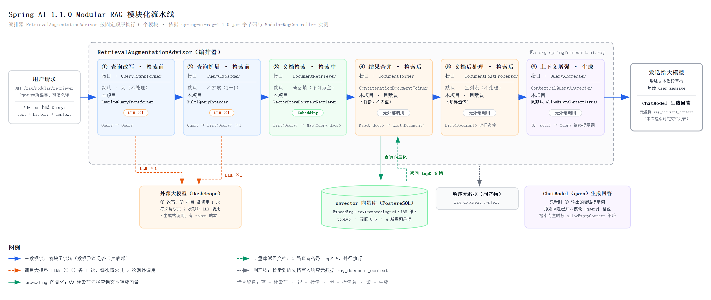

# 介绍
初探 Spring AI，相关示例

## Modular RAG（模块化 RAG）

Spring AI 把 RAG 拆成 6 个可替换的模块，由 `RetrievalAugmentationAdvisor` 按固定顺序编排（`org.springframework.ai.rag` 包）。
示例见 `rag` 模块的 [ModularRagController](rag/src/main/java/com/jiegiser/llm/controller/ModularRagController.java)，
接口：`GET /rag/modular/retriever?query=...`

| # | 阶段 | 接口 | 默认实现 | 本项目实现 | 外部调用 |
|---|------|------|----------|------------|----------|
| ① | 查询改写（检索前） | `QueryTransformer` | 无（不处理） | `RewriteQueryTransformer` | LLM ×1 |
| ② | 查询扩展（检索前） | `QueryExpander` | 不扩展（1→1） | `MultiQueryExpander`（3 变体 + 原问题） | LLM ×1 |
| ③ | 文档检索（检索中） | `DocumentRetriever` | ——（必填） | `VectorStoreDocumentRetriever`（topK=5，阈值 0.6） | Embedding |
| ④ | 结果合并（检索后） | `DocumentJoiner` | `ConcatenationDocumentJoiner` | 用默认（拼接、不去重） | 无 |
| ⑤ | 文档后处理（检索后） | `DocumentPostProcessor` | 空列表（不处理） | 用默认 | 无 |
| ⑥ | 上下文增强（生成） | `QueryAugmenter` | `ContextualQueryAugmenter` | 同默认 + 中文模板 + `allowEmptyContext(true)` | 无 |

几个关键机制（基于 spring-ai-rag-1.1.0 字节码验证）：

- ⑥ 的产物会**整段替换**原始 user message（`Prompt.augmentUserMessage`），原始问题通过模板 `{query}` 槽位保留。
- `{context}` = 各 `Document.getText()` 用换行拼接，**metadata 不进入提示词**；需要来源标注请自定义 `documentFormatter`。
- `allowEmptyContext(true)`：检索为空时原样返回用户问题（不附加“仅依据上下文回答”约束）；此时 `emptyContextPromptTemplate` 完全不生效（它仅在 `false` 时被使用，且为无变量渲染，内部不能写 `{query}`）。
- ④ 不显式配置时默认就是 `ConcatenationDocumentJoiner`，与注释掉 `.documentJoiner()` 行为相同。
- ② 扩展出 4 路查询后 ③ 会并行检索 4 次（每路 topK=5），最多 20 段文档进入提示词且默认不去重。